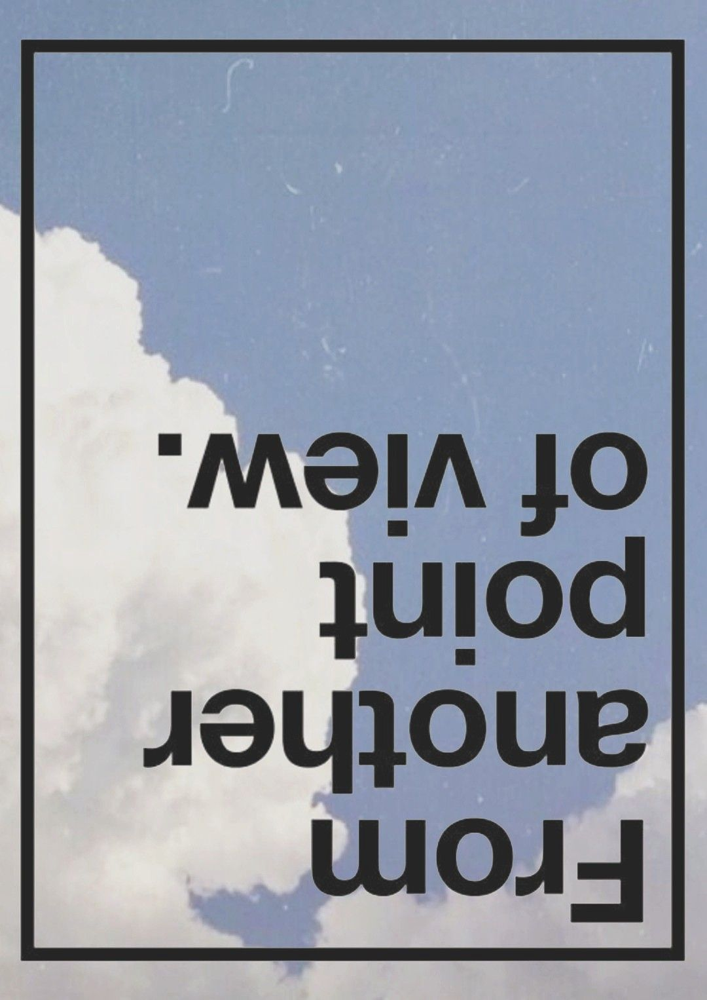

  

<h1 align="center">ABOUT ME</h1>

<table align="center">
  <tr>
    <td width="300" align="center">
      
    </td>
    <td>
      

        Hey, I'm <b>Pughal</b>. Second-year <b>B.Tech IT</b> student at
        <b>Nandha Engineering College</b>. I build things before I fully know
        what I'm doing, then figure it out along the way.
      

      

        
        
        
      

    </td>
  </tr>
</table>

---

<h1 align="center">Experience</h1>

  
<b>Frontend Engineering Intern</b> FlyRank

---

### Languages & Frameworks

### Databases

### Tools & Deployment

  

